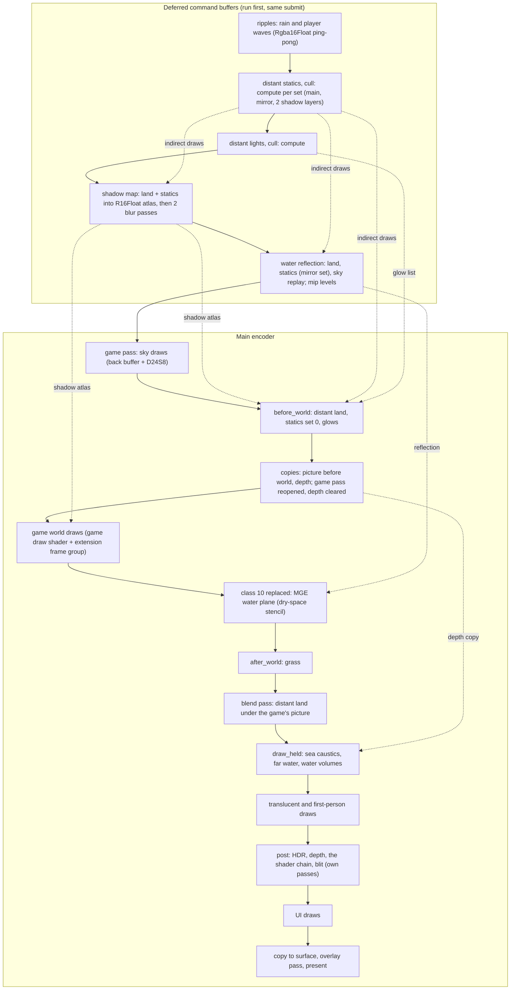

# The wgpu renderer

With `[runtime] renderer_wgpu = true` (the default) MGE XE makes no Direct3D device. The game's
draws go as records through shared memory to `mgeHost64.exe --live`, which draws them with
wgpu (Vulkan or Direct3D 12) together with everything MGE XE adds. This page is the
architecture of that renderer: the processes, the frame, every pipeline with its bind groups,
and the conventions that a change must keep. The player's view is in
[`RENDERER.md`](../../RENDERER.md).

The page cites functions and types, not line numbers. Two repositories take part:

- this repository: `d3d8.dll` (namespace `Deviceless`) and the helper `mgeHost64`
  (`mgeHost64/src/renderer.rs` and `mgeHost64/src/renderer/`);
- `nirender-plugin`, a sibling checkout: the MWSE plugin `nirender.dll` (32-bit) and the crate
  `nirender_wgpu` (`host/`, 64-bit), which `mgeHost64` links by path.

## 1. Processes

```text
Morrowind.exe (32-bit)                                 mgeHost64.exe --live (64-bit)
+------------------------------------------+          +--------------------------------------+
| game code -- Direct3D 8 calls -->        |          | nirender_wgpu (crate)                |
|   nirender.dll (MWSE plugin)             |  shared  |   device, surface, window            |
|     ports of the renderer functions      |  memory  |   replay of the game's draws         |
|     records of each frame  ------------------ring---->  trait Extension, SceneView        |
| d3d8.dll (MGE XE, Deviceless)            |          |   overlay (F10), capture, errors     |
|   weather, settings, mge API, vis groups |          |                                      |
|     extension records 1-8  ------------------------>  DistantLand (impl Extension)        |
| MWSE.dll + Lua mods: mge.*, nirender.*   |          |   land, statics, grass, shadows,     |
+------------------------------------------+          |   water, volumes, lights, post       |
                                                      +--------------------------------------+
```

- `d3d8.dll` loads `Data Files\MWSE\lib\nirender.dll` and hands the game the plugin's own
  `IDirect3D8`. The plugin replaces the engine's renderer functions, writes each frame as
  records into the ring, and starts the helper.
- `Deviceless::present` (`d3d8/cpp/mge/mged3d8device.cpp`) adds MGE XE's own state as extension
  records. `DistantLand::init` stops early without a device, so the distant land of
  `d3d8.dll` stays unloaded; the helper reads the data files itself (see
  [distantland-data.md](distantland-data.md)).
- The helper draws in absolute f32 world space. The game's draws are camera-relative through
  the f64 origin of the scene record.

### Extension records (game to helper)

| Id | Record | Kept | Sent |
| --- | --- | --- | --- |
| 1 | environment (fog, sun, weather, scattering, camera flags) | no | every Present |
| 2 | shader state (chain, enabled flags, variables) | no | on a change |
| 3 | picture request (`mge.saveScreenshot`, the screenshot macro) | no | at Present |
| 4 | settings (`MGEFlags`, distances, water, lighting mode) | no | on a change |
| 5 | tune text (`nirender.tune`) | no | from Lua |
| 6 | water looks | yes | on a change |
| 7 | water masks (dry spaces) | yes | on a change |
| 8 | vis groups | yes | on a cell change or a load |
| 9 | status text (`StatusOverlay::setStatus`): warning, ms to show, text | no | at Present after a new text |

A kept record (bit `0x80000000`) stays in the stream, so a capture file holds it. Use kept
records for state. The next free id is 10. The ids are constants at the top of `renderer.rs`
and in `Deviceless`; each side names the other.

The environment flags (record 1): 1 exponential fog, 2 under water, 4 an exterior or an
interior like one, 16 in a water volume, 32 in a dry space, 64 in a menu, 128 a mouse click
in this frame, 256 a game was loaded (in one record only; the helper latches it in `data()`,
because a loading screen has no world frame).

### Messages (helper to game)

The helper's `Extension::messages` go at the end of each live frame into the shared memory
`<ring>.messages` (a ring of number, length, bytes; 64 KB; the plugin makes it). The plugin
reads it at each frame end and calls `MGE_StreamMessage(id, data, length)` of `d3d8.dll`
(`Deviceless::message`). A replay drops the messages.

| Id | Message | Sent |
| --- | --- | --- |
| 1 | distant land: version 1, reason 1 loaded / 2 arrived | `LOADED` once; `ARRIVED` after a game load or a jump of more than 2 cells, when `Statics::settled` (or after 10 s) |

`d3d8.dll` queues the reasons (`distantlandready.h`, also filled by the Direct3D 9 path); the
Lua of MGE XE (`MGE XE Options/events.lua`) takes them through the FFI export
`MGE_DistantLandReadyNext` and triggers the MWSE event `distantLandReady { reason }`.

## 2. Device

`Renderer::new` (`nirender_wgpu`, `host/src/lib.rs`):

- Instance flags from the environment (`with_env`: `WGPU_VALIDATION`, `WGPU_DEBUG`, ...).
  Adapter: high performance, compatible with the surface. Backend: `[runtime]
  renderer_backend` (`auto`, `vulkan`, `dx12`).
- Features: `TEXTURE_COMPRESSION_BC` always. Only when the adapter has them:
  `POLYGON_MODE_LINE` (wireframe pipelines), `TIMESTAMP_QUERY` and
  `TIMESTAMP_QUERY_INSIDE_ENCODERS` (GPU times), `INDIRECT_FIRST_INSTANCE` and
  `MULTI_DRAW_INDIRECT_COUNT` (GPU culling of the distant statics; without them the CPU
  chooses the places).
- Limits: the wgpu defaults, except `max_texture_dimension_2d` = min(adapter, 16384),
  `max_sampled_textures_per_shader_stage` = min(adapter, 32), `max_buffer_size` = the
  adapter's. So there are 4 bind groups and 8 storage buffers per stage; the statics cull uses
  all 8 in one stage.
- Formats: depth `Depth24PlusStencil8` everywhere (stencil bit `0x02` counts the dry spaces).
  The game draws into an off-screen back buffer (`Bgra8Unorm`, else the first non-sRGB
  format of the surface; `Rgba8Unorm` in a replay), copied to the surface at the end of the
  frame. No MSAA anywhere.
- Surface: `AutoNoVsync`, frame latency 2.

## 3. The frame

### 3.1 Command buffers and submits

One frame is one submit: `[deferred buffers of the extension, in defer order..., main
encoder]`. An extension never submits. For GPU work before the frame it records its own
encoder and calls `scene.commands.defer(encoder.finish())` (`FrameCommands`); the host sends
those buffers first. `queue.write_buffer` is staged until that submit, so it lands before
every buffer of the frame: a buffer that two deferred encoders read must not get two values
in one frame.

Other submits happen only on demand: a game read of pixels or a copy into a render texture
mid-frame (a flush), picture files, the growth of the statics pools, a statics report, and
`submit_now` for the encoders timed with `MGE_XE_GPU_TIME=1` (replay only).

### 3.2 Order

Recording order in the main encoder; the deferred buffers run before all of it.



| Step | Extension hook | Pass | Condition |
| --- | --- | --- | --- |
| frame values, ripples | `frame` (first world draw) | deferred | ripples on and game time moved |
| statics cull | `before_world` -> `Statics::prepare` | deferred compute | GPU culling |
| lights cull | `before_world` -> `DistantLights::prepare` | deferred compute | night, exterior, `lights.data` loaded |
| shadow map | `before_world` | deferred ("shadow map", "shadow blur") | shadows on, distant cell |
| water reflection | `before_world` | deferred ("water reflection", levels) | water in view |
| land, statics, glows | `before_world` | game pass | distant cell |
| water plane | `draw_class` (class 10) | game pass | water cell |
| volumes in place | `draw_held_in_place` | game pass | a surface with its own stencil |
| grass | `after_world` | game pass | distant cell |
| blend | `blend` | own pass, colour only | `before_world` drew |
| caustics, far water, volumes | `draw_held` | game pass | held shapes or far water |
| post | `post` | own passes | chain not empty |

The host opens a new game pass after every copy, target change or extension pass, and calls
`BoundGroups::forget` there, so groups 0 to 2 of the game draws are set again.

## 4. Pipelines and bind groups

Group 0 changes least and the last group changes most, within each pipeline. No pipeline has
an empty group, an automatic layout or immediate (push) constants. "Rate" is how often the
bound group object changes. V = vertex, F = fragment, C = compute.

### 4.1 Host: the game's draws (`nirender_wgpu`)

**"game draw"**: one pipeline per `PipelineKey` (vertex format, topology, blend, depth,
stencil, cull, fill, colour mask), one layout "draw" for all. WGSL: `host/src/shader.wgsl`
plus the extension's `draw_shader` text. Vertex buffers: the game's vertices, a 64-byte
"vertex defaults" buffer (instance step) for attributes a vertex lacks, the instance world
matrix (locations 9-12). Indices `Uint16`.

| Group | Layout | Bindings | Rate |
| --- | --- | --- | --- |
| 0 | extension frame | 0 uniform `FrameParameters` (512 B), 1 texture (shadow atlas or white), 2 sampler, 3 uniform cluster grid, 4-5 storage cluster table and indexes (VF) | frame |
| 1 | draw samplers | 0-5 sampler per texture stage (F) | material |
| 2 | draw textures | 0-5 texture per stage (F) | material |
| 3 | draw | 0 uniform `DrawData`, dynamic offset; 1 storage lights of the frame; 2 storage bone palette (V) | draw (offset) |

Groups 0-2 are set only when they change (`BoundGroups`); group 3 gets a new offset each draw.

**"screen draw"**: film frames and screen-space draws. Group 0: texture, sampler (F); a new
group per draw. Depth test always, no depth write.

**overlay**: made by `egui_wgpu` inside the crate.

### 4.2 Helper: distant land and statics

**"distant land"** (fill, lines, mirror fill, mirror lines; `make_gpu` in `renderer.rs`).
Vertices: 20 bytes (`Float32x3`, `Unorm8x4`, `Unorm8x4`), indices `Uint32`.

| Group | Layout | Bindings | Rate |
| --- | --- | --- | --- |
| 0 | distant lights, baked (`LightBinding`) | 0 uniform, 1 texture of the tiles, 2 texture `Sint` index, 3 sampler (VF) | frame |
| 1 | distant land | 0 uniform (VF), 1-5 textures atlas, material, flags, albedo, patterns, 6 sampler (F) | pass (main or mirror) |

**"distant land shadow"**: group 0 is the "distant land" layout (one group per shadow layer).
R16Float target.

**"distant statics"** (back/front cull x fill/lines; `make_gpu` in `renderer/statics.rs`).
Vertices: 20 bytes (`Float16x4` position and palette number, `Unorm8x4` normal, `Unorm8x4`
colour, `Float16x2` uv); instance 80 bytes (locations 4-8); indices `Uint16`. Draws:
`multi_draw_indexed_indirect_count` per texture, or the CPU path.

| Group | Layout | Bindings | Rate |
| --- | --- | --- | --- |
| 0 | distant lights, baked | as above | frame |
| 1 | distant statics | 0 uniform (VF), 1 storage palettes (V), 2 sampler (F) | set (main, mirror, shadow 0, shadow 1) |
| 2 | distant statics, textures | 0 texture (F) | texture |

**"distant statics shadow"**: the same pipeline layout; its WGSL uses groups 1 and 2 only.
R16Float target.

**"grass"** (fill, lines): group 0 "grass" (uniform, sampler; frame), group 1 the statics
texture layout (texture run). Instance 48 bytes (locations 4-6).

**"distant statics, cull"** (compute, `renderer/statics/cull.rs`; entries `cull` and
`compact`, workgroup 256). Group 0, one per set: 0 uniform, 1-5 storage read (places,
subsets, vis groups, world list, buckets), 6 storage flags, 7 storage indirect draws, 8
storage counts (atomics). `cull` runs over the places, `compact` writes the draws of each
texture in a fixed order.

**"distant lights, cull"** (compute, `renderer/distant_lights.rs`): group 0: uniform,
sources, glow list, indirect arguments (atomics). **"distant lights, glows"**: group 0:
uniform (VF), glow list (V); `draw_indirect`, no vertex buffers, additive, no depth write.

### 4.3 Helper: shadows

**"shadow blur"** and **"shadow debug"** (`renderer/shadow.rs`) share one layout: 0
uniform (VF), 1 texture, 2 sampler (F). Blur: 2 groups, one per pass, R16Float. Debug: with
`MGE_XE_SHADOW_DEBUG`.

### 4.4 Helper: water

**"water"** (fill, lines, cut; `renderer/water.rs`) uses the shared water layout as group 0,
a new group each frame (`gpu::frame_group`):

| Binding | Holds | Stage |
| --- | --- | --- |
| 0 | uniform of the water | VF |
| 1, 2 | reflection texture, clamp sampler | F |
| 3, 4 | waves (3D texture), wave sampler | VF |
| 5 | copy of the picture | F |
| 6 | copy of the depth (depth texture) | F |
| 7, 8 | rain and player ripples | F |
| 9 | depth of the reflection | F |
| 10 | depth before the world, or a 1x1 "no land" depth | F |

**"water reflection level"**: group 0 texture, sampler; one group per mip level.

**"water dry spaces"** (zero, count plane, count behind; `renderer/water/dry.rs`): the water
layout as group 0; stencil writes only, no colour.

**"water volume"** and **"water volume, far"** (`renderer/water/volume.rs`): one pipeline per
key; a mod water shader adds its own module.

| Group | Layout | Bindings | Rate |
| --- | --- | --- | --- |
| 0 | water | as above | frame |
| 1 | water volume light | 0 uniform, 1 shadow atlas, 2 storage lights, 3 uniform clusters, 4-5 storage cluster table and indexes (F) | call |
| 2 | water volume mesh | 0-1 textures of the mesh, 2 sampler (F) | mesh (a new group per draw for a mod shader) |
| 3 | water volume | 0 uniform `Surface`, dynamic offset (VF) | draw (offset) |

**"caustics"** (plain, cut): group 0: uniform, depth, waves, sampler (F); a new group each
frame. Multiply blend.

**"ripples"** (step, player): group 0: texture, sampler, uniform with a dynamic offset; one
group per ping-pong texture.

### 4.5 Helper: blend and post

**"blend"**: group 0: uniform, picture (non-filterable), depth (F); a new group each frame.
Alpha blending, colour only.

**post chain** (`renderer/post.rs`): one pipeline per shader pass, one pipeline layout
"post shaders" for all. Group 0 "post", 31 bindings, a new group per pass per frame:

| Bindings | Holds | Rate |
| --- | --- | --- |
| 0 | uniform of the variables | frame |
| 1, 2 | `lastshader`, `lastpass` | pass |
| 3 | linear depth (non-filterable) | frame |
| 4 | waves (3D) | frame |
| 5-9, 21 | samplers | fixed |
| 10, 22-30 | the shader's own textures | shader |
| 11 | uniform pass information | pass |
| 12-19 | `pass0` to `pass7` | pass |
| 20 | uniform `modv` | shader |

**"post depth"** (R32Float), **"post blit"** and **"post hdr"** (one `blit_layout`), and
**"post debug"** (`MGE_XE_POST_DEBUG`) are full-screen passes with one group each.

## 5. Conventions for a change

- **One submit a frame.** Defer pre-frame GPU work; `submit_now` only where the result is
  read at once.
- **Bind groups from least to most changing**: group 0 the frame, the last group the draw.
  Use a dynamic offset into one pooled uniform buffer for per-draw values.
- **Uploads with `queue.write_buffer`**; no buffer made per frame. A bind group made each
  frame goes through `gpu::frame_group`, so the marks count it.
- **A label on every GPU object**, and a debug group around each part drawn into the game's
  pass, so a capture tool and a validation message name it.
- **Errors**: `gpu::watch` logs uncaptured errors (`gpu error N (kind, adapter ...)`) and
  the program goes on; the broken draw or pass does nothing. A lost device is logged, a
  message box comes up, and the host drains the stream. Post shaders of mods compile inside
  an error scope. After a shader or layout change, look for `gpu error` in the log.
- **WGSL** lives in Rust string constants, composed with `format!` (for example
  `distant_lights::baked_wgsl(group)` puts the baked light into the group the caller names).
  Mod shaders are `.wgsl` files: post shaders (see
  [`mgeHost64/POST_SHADERS.md`](../../mgeHost64/POST_SHADERS.md)) and water shaders (see
  [`water-shaders.md`](../water-shaders.md)).
- **Features**: ask only for what the adapter has, and keep a fallback.
- **Switches**: an environment switch `MGE_XE_<NAME>` for an A/B and a fallback; GPU times
  with `MGE_XE_GPU_TIME=1`.

## 6. Review of the bind group layouts (2026-10-15, open)

Read against the code for this page. The order inside each pipeline follows the convention
of section 5. These points are not wrong for wgpu, but a reader who knows the usual layout
would ask about them:

1. **Group 0 means something else in each pipeline of the same pass**: the extension frame
   (game draws), the baked light (land, statics), grass values, the glow view, water,
   caustics. A common design gives all pipelines of a pass one shared frame group 0 (camera,
   fog, sun, time, the shadow atlas, the lights) and keeps it bound. Here each pipeline
   switch sets group 0 again; wgpu drops a repeated set of the same group, and the measured
   cost of all pass commands is 0.03-0.13 ms a frame.
2. **One layout at two group numbers**: the "distant land" layout is group 1 of the land and
   group 0 of the land shadow; the statics texture layout is group 2 of the statics and group
   1 of the grass. This is valid, but a shared frame group 0 (point 1) would put each layout
   at one number.
3. **Bindings that a shader does not read**: the statics shadow pipeline has the baked-light
   group 0 in its layout and does not use it; the land shadow group carries the five land
   textures and uses only the uniform.
4. **Per-frame data in the per-draw group**: group 3 of the game draws holds the lights of
   the frame and the bone palette next to the per-draw slot. A growth of those buffers
   rebuilds every slot group.
5. **Post: one group of 31 bindings, made for each pass**: fixed samplers, frame values,
   shader textures and pass inputs share group 0. The usual split is a frame group, a shader
   group and a pass group.
6. **Water volumes**: group 1 (light) is set again for each surface, and a mod water shader
   gets a new group 2 for each draw.

Measured (2026-10-15): the bind groups made each frame cost 0.067-0.085 ms (18-21 groups), so
none of these is a cost to remove. Whether to change them for the reader is open.
